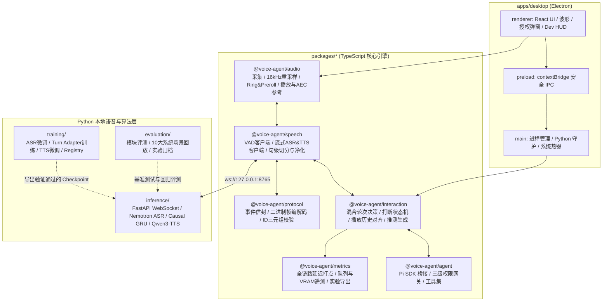
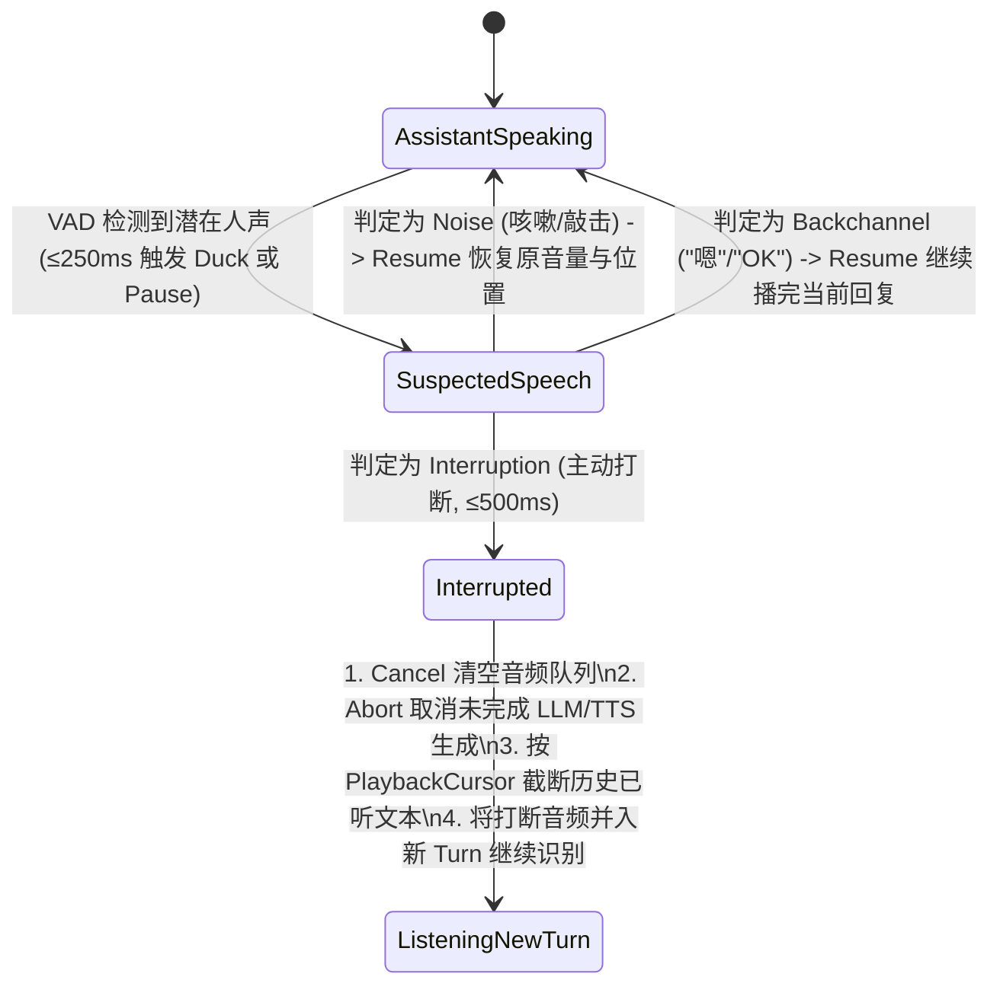

# VoiceAgent 模块功能与接口设计说明书

本文档基于 [PRD V1.0](live/VoiceAgent_PRD.md) 第 4–9 章及目录结构规范，逐一明确全系统 **9 大核心模块**的职责边界、需求映射（FR-01 ~ FR-36）、状态机设计、核心 TypeScript / Python 接口契约及异常处理规则。

---

## 0. 模块依赖全景图



---

## 1. 桌面应用模块（`apps/desktop`）

**覆盖需求**：GUI 主界面、四种交互模式、双轨状态展示、授权交互弹窗、开发者模式 HUD（PRD §5.1–§5.4）。

### 1.1 子目录职责

| 子模块 | 运行环境 | 核心功能职责 |
|---|---|---|
| `apps/desktop/main/` | Electron Main (Node.js) | 1. 启动、健康检查并守护本地 Python 推理服务子进程（异常退出自动指数退避重启）；<br>2. 协调 `interaction` 与 `agent` 核心编排器；<br>3. 注册全局快捷键（Push-to-talk 按住说话、紧急静音/停止）；<br>4. 管理本地配置文件与安全环境变量。 |
| `apps/desktop/preload/` | Isolated Preload | 通过 `contextBridge` 暴露最小化、强类型的双向 IPC 通道（严禁向渲染层直接开启 `nodeIntegration`）。 |
| `apps/desktop/renderer/` | Chromium Renderer (React) | 1. **主对话视图**：实时滚动展示用户 Partial/Final 转写、Agent 流式回复、工具执行进度卡片；<br>2. **交互控制栏**：切换 `Hands-free` / `Push-to-talk` / `Text` / `Mute` 模式，选择输入/输出音频设备；<br>3. **独立双轨状态机展示**：采集轨（`Idle` / `Listening` / `Muted`）与输出轨（`Idle` / `Thinking` / `Executing` / `Speaking` / `Interrupted` / `Awaiting Approval` / `Error`）可同时激活；<br>4. **工具授权审批模态框**：清晰列出工具名、目标路径、完整命令、变更摘要与风险等级，支持点击或明确语音口令审批；<br>5. **开发者模式（Dev HUD）**：实时绘制音频波形、VAD 曲线、Turn Adapter 三头概率曲线、TTFT/TTFA/E2E 延迟拆解、VRAM 占用，支持一键切换模型 Checkpoint、回放测试音频与导出 JSONL 实验日志。 |

---

## 2. 音频采集与播放管线（`packages/audio`）

**覆盖需求**：FR-01 ~ FR-07（采集、设备选择、16kHz 单声道重采样、Ring/Pre-roll Buffer、AEC、降噪、文件/内录输入）及 FR-33 ~ FR-34 底层播放控制。

### 2.1 子文件设计

| 文件 | 核心职责与技术约束 |
|---|---|
| `capture.ts` | 封装麦克风及音频文件/系统内录输入源（FR-01, FR-02, FR-07）；基于 `AudioWorkletNode` 持续输出固定时长（默认 20ms）的连续音频帧并附带单调时钟时间戳 `ptsMs`，**绝不在采集层根据静音截断音频流**，确保后端流式 Encoder 上下文连续。 |
| `resampler.ts` | 将声卡原生采样率（常见 44.1 kHz / 48 kHz 双声道）高质量下采样并混音为 **16,000 Hz 单声道 `Int16` / `Float32` PCM**（FR-03），带抗混叠低通滤波。 |
| `ring-buffer.ts` | 基于 `SharedArrayBuffer`（或定长循环数组）实现零拷贝无锁 **Ring Buffer** 与默认 300ms **Pre-roll Buffer**（FR-04），防止句首辅音在 VAD 刚触发时被截断，同时设置严格容量上限杜绝内存无限增长（PRD §8.2）。 |
| `playback.ts` | 管理 TTS 输出音频流（如 24 kHz PCM）的无损拼接播放队列（FR-33, FR-34）：<br>- 支持毫秒级响应 `duck(gain)`、`pause()`、`resume()`、`cancel(generationId)`；<br>- 实时记录每个 `tts.chunk` 对应的字符偏移区间，每播放完一个块或发生暂停/取消时精确触发 `onPlaybackProgress(PlaybackAck)`，并同步将实际送往扬声器的参考帧喂给 **AEC（回声消除）** 管线（FR-05, FR-06）。 |

### 2.2 核心接口契约（TypeScript）

```typescript
export interface AudioFrame {
  readonly pcm16: Int16Array;       // 16kHz 单声道采样数据 (20ms = 320 samples)
  readonly sampleRate: 16000;
  readonly ptsMs: number;           // 单调递增采集时间戳 (performance.now 基准)
  readonly rmsDb: number;           // 帧能量，供 UI 波形渲染与快速能量门限使用
}

export type PlaybackMode = "playing" | "ducked" | "paused" | "idle";

export interface PlaybackController {
  enqueueChunk(chunk: TtsAudioChunk): void;
  duck(targetGain?: number, rampMs?: number): void; // 默认压低至 0.15 音量
  pause(): PlaybackCursor;                          // 保留当前采样点偏移
  resume(rampMs?: number): void;                    // 从暂停采样点平滑恢复
  cancel(generationId?: string): PlaybackCursor;    // 立即丢弃指定或全部待播队列并返回实际已播游标
  getCurrentCursor(): PlaybackCursor;
}

export interface PlaybackCursor {
  readonly turnId: string;
  readonly generationId: string;
  readonly playedDurationMs: number;
  readonly playedCharIndex: number; // 对应已实际被用户听到的回复文本字符位置
}
```

---

## 3. 语音服务客户端与文本缓冲（`packages/speech`）

**覆盖需求**：FR-08 ~ FR-14（流式 ASR、Partial/Final、缓存管理、特征开关、模型热切换）、VAD 事件接入（§4.3）、FR-30 ~ FR-32 & FR-35 ~ FR-36（流式 TTS、句级缓冲、文本净化、微调/音色切换）。

### 3.1 子文件设计

| 文件 | 核心职责 |
|---|---|
| `vad.ts` | 消费后端或本地 Silero VAD 输出的概率流，维护语音起止边界事件（`vad.start` / `vad.end`），并向 `TurnManager` 实时广播语音活跃度证据（注意：**VAD 不单独决定整轮发言结束**）。 |
| `asr-client.ts` | 通过本地 WebSocket 流式推送 `AudioFrame`；接收并归一化 `asr.partial`、`asr.final` 与 `turn.prediction` 事件；提供模型/热词/微调 Checkpoint 动态切换指令封装。 |
| `tts-client.ts` | 内置 **可读文本净化器（Speech Text Sanitizer）** 与 **自适应句级缓冲器（Sentence Buffer）**：<br>1. **严格过滤规则（PRD §4.7）**：剥离 Markdown 代码块（`` ``` ``）、行内长路径/命令串、工具调用结构化参数与内部 `<think>` 推理内容，仅保留自然语言可朗读文本；<br>2. **低延迟首句切分**：每轮回复第 1 句遇到首个自然停顿标点（`，`、`,`、`。`、`.`、`：` 且满足最小词长）即立即下发合成以最小化 TTFA；第 2 句起按完整句号/问号/叹号切分以保证韵律连贯；<br>3. 按 `generationId` 接收流式 `tts.chunk` 并过筛丢弃已被取消的过期块。 |

---

## 4. 全双工交互与轮次控制引擎（`packages/interaction`）

**覆盖需求**：FR-15 ~ FR-20（轮次结束、句中停顿、主动打断、附和识别、策略切换、超时回退）、全双工交互控制（§4.5）、推测式生成（§4.8, P2）、基于实际播放进度的会话历史对齐（§7.4）。

### 4.1 混合轮次决策器（`turn-manager.ts`）

融合五维实时信号输出交互裁决：
1. **VAD 证据**：当前静音持续时长 `silenceDurationMs` 与语音段总长。
2. **Turn Adapter 概率**：后端因果 GRU 输出的 `p_completion`（发言完成）、`p_floor_taking`（抢占话轮/打断）、`p_backchannel`（非抢话附和）。
3. **助手播放状态**：当前是否处于 `Speaking` / `Ducked` / `Paused` 以及已播放时长。
4. **ASR 增量文本特征**：尾词语法完整性、典型附和短词集合（如 `"yeah"`, `"uh-huh"`, `"ok"`, `"got it"`, `"嗯"`, `"好的"`）与打断触发词（`"wait"`, `"stop"`, `"hold on"`, `"等一下"`）。
5. **保守静音超时回退（FR-20）**：即使 Adapter 置信度模糊，当连续静音超过 `conservative_silence_timeout_ms`（如 1100ms）时保底触发提交，避免系统死锁不回复。

支持在配置或开发者面板一键切换 5 种策略以服务消融实验（`TURN-A0` ~ `TURN-A5`）：
`"fixed_silence" | "vad_only" | "smart_turn" | "adapter" | "hybrid"`。

### 4.2 全双工打断状态机（`interruption.ts`）



### 4.3 播放感知的会话历史管理（`playback-state.ts`）

严格落实 PRD §7.4：
- 当第 $k$ 轮回复在播放途中被用户主动打断时，假定 LLM 已流式生成了 300 字符，但 `PlaybackCursor` 表明扬声器仅实际播出了前 92 字符（例如只播完第一句 `"I checked your disk usage, and..."`）。
- 系统将正式会话记录同步标记为：`[Assistant (interrupted after audible prefix)]: "I checked your disk usage, and..."`，丢弃未播放的后 208 字符，使下一轮 LLM 准确获知用户实际听到了哪些信息、没听到哪些信息。
- **工具状态铁律**：任何在打断发生前已经执行完毕或已产生外部状态的 Tool Call 及其返回结果，**完整保留在 Agent 上下文中**，绝不因语音未播报而丢失。

### 4.4 推测式生成控制器（`speculative.ts`，优先级 P2）

- 当用户处于 `Listening` 末尾且 `p_completion` 跨过预热阈值（如 `0.55`）但尚未最终确认 `turn.commit` 时，以当前 `partialTranscript` 启动带 `speculative: true` 标记的候选生成。
- **三大隔离约束**：候选生成在 `turn.commit` 校验通过前，① **禁止送入音频播放硬件**；② **禁止写入正式 Session 历史**；③ **禁止触发任何非纯内存只读的外部工具调用**。
- 一旦 `asr.final` 确认与预热文本语义一致（归一化编辑距离在容差内），立即升级（Commit）为正式回复流；若用户继续补充发言导致文本变化，静默销毁（Discard）该 `generationId`。

---

## 5. Pi Agent 集成与安全权限引擎（`packages/agent`）

**覆盖需求**：FR-21 ~ FR-29（Pi SDK 接入、配置复用、多轮会话、增量事件、工具状态、生成取消、权限控制、Spaces 工作空间、Computer Use）与工具安全架构（PRD §4.9、§8.3）。

### 5.1 子文件设计

| 文件 / 目录 | 核心职责 |
|---|---|
| `pi.ts` | 封装 Pi Agent SDK 会话生命周期：加载并复用用户本地 Pi 模型与 Provider 配置（FR-22）；绑定每轮 `AbortController` 以支持毫秒级取消 LLM 流式推理（FR-26）；将 Pi 的文本流事件解耦拆分为 UI 完整展示流与 TTS 可朗读文本流。 |
| `permissions.ts` | **独立工具权限守卫（Tool Permission Gatekeeper）**：拦截 Pi Agent 发出的每一次工具调用请求，在真正执行函数体前强制校验当前运行模式与权限策略。 |
| `tools/` | 面向桌面语音场景扩展并加固的工具包（文件检索与读写、受控终端命令、系统状态查询，以及 P3 阶段的屏幕感知与键鼠操控 Computer Use 工具）。 |

### 5.2 模式与三级权限矩阵（`permissions.ts`）

| 工具风险分类 | 示例操作 | `Conversation` 模式 | `Action` 模式 (`Readonly`) | `Action` 模式 (`Ask` 默认) | `Action` 模式 (`Trusted`) |
|---|---|---|---|---|---|
| **无副作用只读** | 读取允许目录内文件、查询时间/系统指标、只读搜索 | 允许 | 允许 | 允许 | 允许 |
| **受控本地写入** | 在授权 Space 内新建/编辑普通文档 | 拦截并提示切换 Action 模式 | 拒绝 | **弹窗/语音请求用户确认** | 仅白名单范围自动放行 |
| **高危/不可逆操作** | 删除/覆盖关键文件、执行任意 Shell 命令、外发网络数据、键鼠点击 | 拒绝 | 拒绝 | **强制明确确认（默认不可跳过）** | **仍需强制明确确认** |

**安全铁律**：
1. **默认拒绝（Fail-Closed）**：`approval.request` 发出后，若用户保持沉默、超时（默认 15s）或说出语义含糊的话（如 `"嗯？"`、`"先看看"`），一律判定为 `denied`。
2. **独立路径与命令边界检查**：工作目录（`cwd` / Space root）本身不构成安全沙箱；每次文件读写必须规范化解析真实路径（`fs.realpath` 防止符号链接逃逸），每次命令执行必须独立解析可执行文件与参数黑名单。

---

## 6. 通信协议与全链路指标包（`packages/protocol` & `packages/metrics`）

- **`packages/protocol`**：定义 TypeScript 与 Python 共享的消息信封、15+ WebSocket 事件类型、二进制音频帧编解码器，以及核心防串台校验器 `isEventActive(sessionId, turnId, generationId)`（详见 [PROTOCOL.md](PROTOCOL.md)）。
- **`packages/metrics`**：
  - 按 `turnId` 采集全链路时间戳：`t_vad_start` → `t_vad_end` → `t_asr_final` → `t_turn_commit` → `t_llm_first_token` → `t_tts_first_chunk` → `t_playback_first_sample`；
  - 分别统计各阶段**纯模型计算时间**与**队列等待时间**，自动标注冷启动（首轮）与热启动，计算 P50 / P95 分位数；
  - 定时汇总 Python 后端上报的 GPU 显存峰值、利用率、ASR/TTS 实时率（RTF），支持一键导出用于实验报告的 JSONL / CSV 数据。

---

## 7. 本地 Python 语音推理后端（`inference/`）

**覆盖需求**：本地流式 ASR、Encoder 特征提取、Causal Turn Adapter 实时推理、流式 Qwen3-TTS 合成、Checkpoint 动态切换与 GPU 显存并发管理。

### 7.1 目录结构与核心类契约

```text
inference/
├── server.py                  # FastAPI + WebSocket 网关 (默认绑定 127.0.0.1:8765)
├── runtime_manager.py         # CUDA Stream 并发隔离、显存监控、热切换与 OOM 保护
├── asr/
│   ├── base.py                # StreamingASRBackend 抽象基类
│   └── nemotron_streaming.py  # Nemotron 0.6B Cache-Aware 流式推理 + 多层 Encoder Hook
├── turn_adapter/
│   ├── model.py               # CausalTurnGRU 网络定义 (~183K 参数)
│   └── predictor.py           # 跨音频块 GRU 隐状态维护与帧级概率输出
└── tts/
    ├── base.py                # StreamingTTSBackend 抽象基类
    └── qwen3_tts.py           # Qwen3-TTS 0.6B 流式音频块生成与音色/微调权重加载
```

### 7.2 核心 Python 接口定义

```python
from dataclasses import dataclass
from typing import AsyncIterator, Protocol
import numpy as np
import torch


@dataclass(slots=True)
class ASRStepOutput:
    partial_text: str
    is_final: bool
    encoder_taps: list[torch.Tensor] | None  # 冻结多层特征，仅当前及历史帧，严禁未来泄漏
    compute_time_ms: float


class StreamingASRBackend(Protocol):
    def reset_state(self, session_id: str) -> None: ...

    def process_chunk(
        self,
        session_id: str,
        pcm_16k: np.ndarray,
        extract_features: bool = True,
    ) -> ASRStepOutput: ...

    def load_checkpoint(self, checkpoint_path: str | None) -> None: ...


@dataclass(slots=True)
class TurnAdapterPrediction:
    p_completion: float          # 发言完成 (EOT) 概率
    p_floor_taking: float        # 主动抢话/打断概率
    p_non_floor_feedback: float  # 附和 (Backchannel) 概率
    inference_time_ms: float


class StreamingTTSBackend(Protocol):
    async def synthesize_stream(
        self,
        text: str,
        generation_id: str,
        speaker_profile: str = "default",
        cancel_event: asyncio.Event | None = None,
    ) -> AsyncIterator[bytes]:
        """流式产出 PCM16 音频块，每次迭代检查 cancel_event 以毫秒级释放算力。"""
        ...
```

---

## 8. 离线模型训练流水线（`training/`）

**覆盖需求**：PRD §3.2（离线训练架构）与 §6.1–§6.3（ASR 微调、Turn Adapter 训练、TTS 微调）。

**核心隔离原则**：`training/` 不被桌面端或 `inference/` 反向引用；所有训练产出经 `evaluation/` 独立测试集验证达标后，写入 `models/registry.json` 方可被在线推理后端挂载。

| 子模块 | 训练任务与对照实验支撑 | 关键技术与防泄漏要求 |
|---|---|---|
| `training/asr/` | 支撑实验 `ASR-A0` ~ `ASR-A3`（基线、热词上下文、领域/口音微调、微调+增强） | 1. 统一 16 kHz 重采样、响度归一化、背景噪声/混响增强；<br>2. 支持 NeMo FastConformer 参数高效微调（LoRA/Adapter）与全参微调；<br>3. **必选门禁**：微调后必须验证 80ms 流式 Cache 推理模式兼容性，并在通用语音测试集上检查灾难性遗忘（通用 WER 退化审计）。 |
| `training/turn_adapter/` | 支撑实验 `TURN-A0` ~ `TURN-A5`（静音阈值、VAD、Smart Turn、Voice-Light 复现、自训练 Adapter、混合控制） | 1. 冻结 `nvidia/nemotron-speech-streaming-en-0.6b` Encoder，提取多层因果帧特征并与二值/连续 `assistant_playback_state` 拼接；<br>2. 训练因果单向 GRU + 三分类预测头（`Completion` / `Floor Taking` / `Non-floor Feedback`）；<br>3. 先在 `Voice-Light Synthetic Audio` 预训练交互语义，再在获授权真人对话数据上微调；<br>4. **严格按完整会话（Session ID）划分 `train` / `val` / `test`**，严禁同一说话人同一通对话跨集合切分；分类决策阈值仅允许在 `val` 集搜索标定，`test` 集严格只读。 |
| `training/tts/` | 支撑实验 `TTS-A0` ~ `TTS-A3`（预训练基线、3s Zero-shot 克隆、少样本微调、不同数据规模消融） | 1. 仅使用本人录音、明确书面授权录音或许可协议允许训练的公开语料；<br>2. 完成静音修剪、ASR 强制对齐文本校验与信噪比筛查；<br>3. 必须以 `TTS-A1`（Zero-shot Voice Cloning）作为强基线，量化证明微调在音色相似度、发音准确率（CER/WER）或稳定性上的真实净收益。 |

---

## 9. 实验与基准评测套件（`evaluation/`）

**覆盖需求**：PRD §9.1–§9.3（模块级指标、10 类系统级测试场景、实验结果全要素归档）。

| 子目录 | 评测对象 | 核心评测指标 |
|---|---|---|
| `evaluation/asr/` | 离线与流式分块 ASR | `WER`、`CER`、领域指令/专有术语识别准确率、`RTF`、峰值推理显存 |
| `evaluation/tts/` | 预训练、零样本克隆与微调 TTS | 合成语音重识别 `CER` / `WER`、说话人嵌入余弦相似度（`Speaker Similarity`）、`TTFA`、`RTF`、主观 `MOS` 盲测脚本 |
| `evaluation/turn_taking/` | 各轮次预测基线与 Turn Adapter | `EOT Recall`、`F1`、`False Cutoff Rate`（句中停顿误截断率）、`Decision Latency` |
| `evaluation/interruption/` | 全双工播放期打断与回声抗扰 | 主动打断停止延迟（P50/P95）、误打断率（噪声/呼吸误触发）、`Backchannel False-cancel Rate`（附和误取消率）、回声抑制 `ERLE` 及扬声器外放误识别率 |
| `evaluation/end_to_end/` | 全链路桌面系统回放与稳定性压测 | 覆盖 PRD §9.2 全部 **10 大系统级场景**的自动化音频注入回放器；统计冷/热启动 P50/P95 端到端延迟、1h/4h 连续运行延迟漂移与内存/显存泄漏曲线 |

### 标准化实验记录结构（Experiment Manifest）
每次运行评测自动生成不可变实验快照（JSON），包含：
`experiment_id`、`git_commit`、`dirty_worktree`、`dataset_id`、`split_hash`、`model_checkpoints`、`hyperparameters`、`hardware_info`（GPU 型号/驱动/CUDA 版本）、`metrics_summary`、`bad_cases_path` 及 `conclusion`（明确支持保留负面实验结果，杜绝幸存者偏差）。
