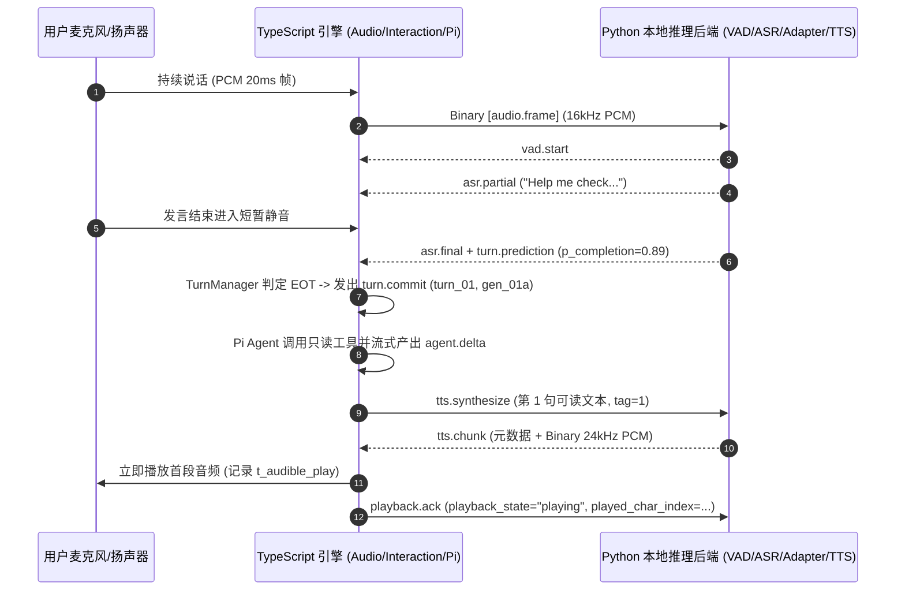
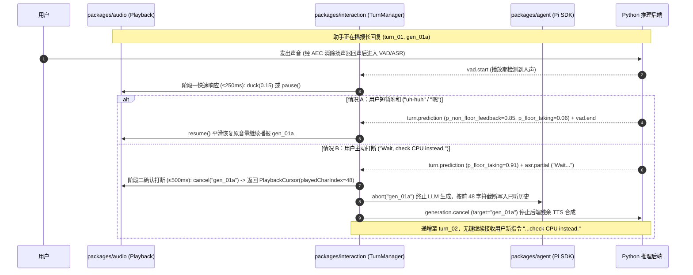

# VoiceAgent 模块间实时通信协议规范（Local WebSocket Protocol）

本文档基于 [PRD V1.0](live/VoiceAgent_PRD.md) §7.3–§7.4，定义 TypeScript 应用编排层（客户端）与本地 Python 语音推理后端（服务端）之间的 **Local WebSocket** 实时全双工通信协议。

---

## 1. 传输层与安全基线

- **监听地址与端口**：默认绑定本机回环地址 `ws://127.0.0.1:8765/ws/v1/voice`（PRD §8.3 强制要求默认不暴露至局域网或公网接口）。
- **消息通道模型**：单条全双工 WebSocket 连接复用两种帧类型：
  1. **UTF-8 Text Frame（JSON 控制与文本事件）**：承载会话握手、VAD 状态、ASR Partial/Final 文本、Turn Adapter 概率、TTS 元数据、任务取消与异常通知。
  2. **Binary Frame（低开销裸 PCM 音频流）**：承载上行麦克风 16 kHz PCM 音频帧、上行 AEC 扬声器参考帧（如由后端做 AEC 时），以及下行流式 TTS 音频块，消除 Base64 编码带来的 33% 体积膨胀与序列化延迟。
- **心跳与重连**：每 `5,000 ms` 交互 `ping` / `pong`；连接意外断开时，客户端立即将 UI 置为可恢复降级态（保留纯文本对话能力），并按 `200ms → 500ms → 1s → 2s` 指数退避自动重连并同步 `session.init`。

---

## 2. 三级会话与生成关联 ID 机制

在全双工可打断交互中，新旧轮次的语音识别、LLM 推理与 TTS 音频块高度异步交错。为彻底防止**“已取消旧任务的残余音频或文本窜入新一轮对话”**（PRD §7.3、§8.2），所有事件与音频块强制携带三级标识符：

| 标识符 | 作用域与生成时机 | 失效与过滤规则 |
|---|---|---|
| `session_id` | 单次完整对话会话（如 `"sess_01J..."`），新建或切换会话时生成 | 会话关闭或重置时，服务端清空该 `session_id` 对应的全部 ASR Cache 与 GRU 隐状态 |
| `turn_id` | 单轮用户发言至对应回复周期（如 `"turn_0012"`），新发言开始或主动打断成立时递增 | 旧 `turn_id` 的迟到事件仅允许归档进调试日志，严禁触发当前轮状态流转 |
| `generation_id` | 单次候选或正式回复生成实例（如 `"gen_0012_a"`），支持同一 `turn_id` 下推测式生成重试 | 一旦某 `generation_id` 被标记为 `generation.cancel`，客户端播放队列与服务端 TTS 协程**立即双端丢弃**所有携带该 `generation_id` 的后续分块 |

---

## 3. JSON 事件统一信封格式（Event Envelope）

所有文本帧遵循统一的顶层 JSON 结构：

```json
{
  "v": 1,
  "type": "turn.prediction",
  "event_id": "evt_01J8Z9K4X2",
  "timestamp_ms": 1764140000123,
  "session_id": "sess_01J8Z9A000",
  "turn_id": "turn_0004",
  "generation_id": null,
  "payload": {}
}
```

---

## 4. 二进制音频帧头格式（Binary Audio Frame）

为兼顾零拷贝性能与严格的多流关联，每个二进制 WebSocket 帧采用 **24 字节定长小端序（Little-Endian）帧头 + 原始 PCM 采样负载**：

| 字节偏移 | 字段名 | 类型 | 说明 |
|---:|---|---|---|
| `0..1` | `magic` | `uint16` | 固定魔数 `0x5641` (`"VA"`) |
| `2` | `version` | `uint8` | 协议版本，当前固定为 `1` |
| `3` | `stream_kind` | `uint8` | `1` = 上行麦克风音频 (`audio.frame`)；`2` = 下行 TTS 音频块 (`tts.chunk`)；`3` = 上行播放参考流 (`aec.reference`) |
| `4..7` | `seq` | `uint32` | 当前流单调递增包序号（用于丢包与乱序检测） |
| `8..15` | `pts_ms` | `float64` | 帧起始单调时间戳（毫秒） |
| `16..19` | `sample_rate` | `uint32` | 采样率（上行固定 `16000`，下行默认 `24000`） |
| `20..23` | `generation_tag` | `uint32` | `generation_id` 的 32 位数值映射号（上行采集帧填 `0`；下行 TTS 帧必填，用于客户端 `O(1)` 快速过滤已取消音频） |
| `24..N` | `pcm_payload` | `int16[]` | 单声道 16-bit 有符号小端 PCM 采样点数组 |

---

## 5. 核心事件目录与 Payload 定义

以下覆盖 PRD §7.3 定义的全部核心事件（含本地内部总线事件与跨进程 WebSocket 事件）：

### 5.1 音频与语音活动事件

| 事件名 | 方向 | 说明与关键 Payload 字段 |
|---|---|---|
| `audio.frame` | TS → Py (Binary) | 连续 16 kHz 单声道麦克风音频帧（默认每帧 20ms = 320 samples = 640 bytes PCM） |
| `vad.start` | Py → TS | 检测到语音起始：`{ "vad_prob": 0.84, "speech_start_pts_ms": 12480.0, "preroll_included_ms": 300 }` |
| `vad.end` | Py → TS | 检测到静音起点：`{ "vad_prob": 0.18, "silence_start_pts_ms": 14920.0, "speech_duration_ms": 2440 }` |

### 5.2 流式语音识别与轮次预测事件

| 事件名 | 方向 | 说明与关键 Payload 字段 |
|---|---|---|
| `asr.partial` | Py → TS | 流式增量识别文本：`{ "text": "Help me check the current", "stability": 0.88, "audio_pts_ms": 14100.0, "compute_ms": 14.2 }` |
| `asr.final` | Py → TS | 句段确认识别文本：`{ "text": "Help me check the current GPU memory usage.", "audio_start_pts_ms": 12480.0, "audio_end_pts_ms": 14920.0, "compute_ms": 18.5 }` |
| `turn.prediction` | Py → TS | 因果 Turn Adapter 实时输出：<br>`{ "p_completion": 0.86, "p_floor_taking": 0.04, "p_non_floor_feedback": 0.02, "assistant_speaking": false, "adapter_version": "turn-gru-v1" }` |
| `turn.commit` | TS 内部 & TS → Py | Turn Manager 裁决用户完成本轮发言并正式提交给 Pi Agent：<br>`{ "final_transcript": "Help me check the current GPU memory usage.", "decision_source": "hybrid_adapter", "decision_latency_ms": 195.0, "speculative_hit": false }` |

### 5.3 Agent 推理、工具执行与权限审批事件

*(注：Pi Agent 运行于 TypeScript 层，相关事件通过内部强类型事件总线同步至 Renderer UI、Metrics 及 Python 状态同步器)*

| 事件名 | 方向 | 说明与关键 Payload 字段 |
|---|---|---|
| `agent.delta` | Agent → Interaction / UI | LLM 增量流输出：`{ "text_delta": "Your GPU is currently using ", "speakable_delta": "Your GPU is currently using ", "is_speculative": false }` |
| `tool.start` | Agent → Interaction / UI | 工具开始执行：`{ "tool_call_id": "call_01", "tool_name": "system.gpu_info", "args_summary": "{}", "risk_level": "readonly" }` |
| `tool.end` | Agent → Interaction / UI | 工具执行完毕：`{ "tool_call_id": "call_01", "status": "ok", "duration_ms": 42, "result_preview": "RTX 5070 Laptop, 5.1 / 8.0 GB" }` |
| `approval.request` | Agent → UI / Voice | 请求用户审批高风险或有副作用操作：<br>`{ "approval_id": "appr_09", "tool_name": "fs.delete", "target_path": "D:/temp/old.log", "command": null, "impact_summary": "永久删除本地日志文件 (12 MB)", "expires_in_ms": 15000 }` |
| `approval.response` | UI / Voice → Agent | 用户明确授权或拒绝结果：<br>`{ "approval_id": "appr_09", "approved": false, "source": "timeout", "reason": "Approval timed out after 15000ms" }` |

### 5.4 流式语音合成、播放反馈与取消控制事件

| 事件名 | 方向 | 说明与关键 Payload 字段 |
|---|---|---|
| `tts.synthesize` | TS → Py | 下发经净化的可朗读完整子句：<br>`{ "sentence_index": 0, "text": "Your GPU is currently using 5.1 gigabytes of memory.", "generation_tag": 104, "speaker_profile": "default" }` |
| `tts.chunk` | Py → TS (JSON + Binary) | JSON 元数据帧声明该音频块映射的文本区间 `{ "sentence_index": 0, "chunk_index": 0, "char_start": 0, "char_end": 27, "duration_ms": 620, "ttfa_ms": 245 }`，紧随对应的 Binary PCM 音频帧 |
| `playback.ack` | Audio → Interaction → Py | 客户端声卡真实播放进度回执：<br>`{ "playback_state": "playing", "played_char_index": 27, "played_duration_ms": 620 }`（同步更新 Python 端 Turn Adapter 所需的 `assistant_playback_state` 特征） |
| `generation.cancel` | TS ↔ Py | 取消指定生成任务：<br>`{ "target_generation_id": "gen_0004_a", "generation_tag": 104, "reason": "user_interruption", "audible_cursor_chars": 27 }` |
| `error` | 双向 | 模块结构化异常上报：<br>`{ "module": "tts", "code": "CUDA_OOM", "message": "Insufficient VRAM during synthesis", "recoverable": true, "fallback_action": "text_only" }` |

---

## 6. 核心交互时序图

### 6.1 正常语音问答与句级流式 TTS 播放



### 6.2 全双工播放期：附和恢复（Backchannel）与主动打断（Interruption）对比


