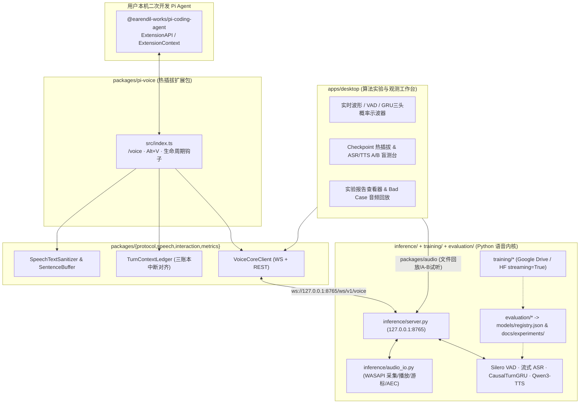

# VoiceAgent 模块功能与接口设计说明书（V2.0）

本文档基于 [PRD V2.0](VoiceAgent_PRD.md) 与 [技术栈规范 V2.0](TECH_STACK.md)，详细定义重构后全系统 **6 大核心子系统**的目录结构、职责边界、状态机流转及 TypeScript / Python 核心接口契约，作为后续编码实现与算法实验的直接依据。

---

## 0. 重构后仓库目录与依赖拓扑

```text
VoiceAgent/
├── packages/
│   ├── pi-voice/            # [支柱二 · 新增核心] 热插拔 Pi Package 语音扩展 (/voice 命令与宿主钩子)
│   ├── protocol/            # 跨语言消息信封、三级 ID 防串台校验器、REST 实验契约
│   ├── speech/              # 本地语音网关客户端、可读文本净化器 (Sanitizer) 与自适应分句器
│   ├── interaction/         # 混合轮次状态机、6 类交互裁决与三账本播放进度对齐器
│   ├── metrics/             # 全链路分阶段延迟打点、RTF 与显存遥测汇总
│   ├── audio/               # WebAudio 采集/播放/RingBuffer (专供桌面工作台回放与浏览器调试)
│   └── agent/               # 轻量 Mock Agent 桩模块 (专供离线单测与无宿主独立回放，不替代真实 Pi)
├── apps/
│   └── desktop/             # [支柱三 · 定位升级] 桌面算法实验与实时观测工作台 (Electron + React)
├── inference/               # [支柱一 · 在线内核] FastAPI/WS 网关、WASAPI 音频守护、VAD/ASR/TurnGRU/TTS
├── training/                # [支柱一 · 离线微调] 云盘/HF 流式数据接口、ASR LoRA、TurnGRU、TTS 微调
├── evaluation/              # [支柱一 · 基准评测] 模块指标评测、全双工场景回放与不可变实验归档
├── configs/                 # 运行时与实验超参 YAML 配置
├── models/                  # 本地模型权重缓存与 models/registry.json 注册表 (Git 忽略大权重)
└── docs/
    ├── live/                # 当前生效的 V2 PRD 与权威技术文档套件
    ├── experiments/         # 实测性能基准、消融表格与 JSON 实验快照
    └── archive/v1/          # 已归档的 V1 独立桌面助手阶段文档
```



---

## 1. 热插拔 Pi 语音扩展模块（`packages/pi-voice`）

**覆盖需求**：FR-10 ~ FR-16。在不侵入用户二次开发 Pi Agent 源码的前提下，赋予宿主类似 AGY / Codex 的原生全双工语音对话模式。

### 1.1 Pi Package 清单规范（`packages/pi-voice/package.json`）

严格遵循 `@earendil-works/pi-coding-agent` v1.4.0 包加载规范：
- 必须包含 `"keywords": ["pi-package"]` 与 `"pi": { "extensions": ["./src/index.ts"] }`；
- 宿主内置包**严禁写入 `dependencies`**，必须声明于 `peerDependencies` 并使用 `"*"` 版本范围，确保与宿主共享同一实例：

```json
{
  "name": "@voice-agent/pi-voice",
  "version": "0.2.0",
  "private": true,
  "type": "module",
  "keywords": ["pi-package", "voice", "asr", "tts", "full-duplex"],
  "pi": {
    "extensions": ["./src/index.ts"]
  },
  "dependencies": {
    "@voice-agent/protocol": "*",
    "@voice-agent/speech": "*",
    "@voice-agent/interaction": "*",
    "@voice-agent/metrics": "*"
  },
  "peerDependencies": {
    "@earendil-works/pi-coding-agent": "*",
    "@earendil-works/pi-agent-core": "*",
    "@earendil-works/pi-ai": "*",
    "@earendil-works/pi-tui": "*",
    "@sinclair/typebox": "*"
  }
}
```

### 1.2 宿主生命周期与事件钩子精确映射

**扩展工厂函数零副作用准则**：`export default function piVoiceExtension(pi: ExtensionAPI)` 执行期间仅注册命令、快捷键、CLI Flag 与事件监听器，**绝不在加载阶段建立 WebSocket 连接或拉起子进程**；网络连接仅在 `--voice` 启用时的 `session_start` 或用户执行 `/voice on` 时按需建立，并在 `session_shutdown` 幂等释放。

| Pi 扩展 API / 事件钩子 | `packages/pi-voice` 绑定逻辑 |
|---|---|
| `pi.registerFlag("voice", { type: "boolean", default: false })` | 支持启动命令 `pi --voice` 自动连接本地语音内核并进入免提监听态。 |
| `pi.registerCommand("voice", ...)` | 注册 `/voice` 命令及参数自动补全：`on`（开启免提全双工）、`off`（关闭语音）、`ptt`（按键说话模式）、`status`（查看当前加载的 ASR/GRU/TTS Checkpoint 与延迟统计）、`engine <qwen3\|fast>`（切换 TTS 引擎）、`speaker <id>`（切换微调音色）。 |
| `pi.registerShortcut("alt+v", ...)` | 免提模式下为快速静音/恢复开关；PTT 模式下触发开始发言/提交发言。 |
| `pi.on("session_start", ...)` | 读取 `--voice` 标志或恢复上一会话语音开关状态；若 Python 内核未启动，按配置自动后台拉起 `uvicorn inference.server:app` 并完成 `session.init(role="controller", audio_mode="local_device")` 握手。 |
| `pi.on("message_update", ...)` | 实时提取 `event.assistantMessageEvent` 中的流式文本增量 → 送入 `SpeechTextSanitizer`（剔除代码块、命令行、路径与思考标签）→ 经 `SentenceBuffer` 切出可读短句后发送 `tts.synthesize`。 |
| `pi.on("turn_end", ...)` & `pi.on("agent_settled", ...)` | 冲刷 `SentenceBuffer` 尾部残余短句送入 TTS；若 `event.aborted === true` 且由用户语音打断触发，固化本轮 `TurnContextSnapshot` 账本。 |
| `pi.on("before_agent_start", ...)` | 检查上一轮是否存在**播放中途被打断**记录：若存在，通过返回 `BeforeAgentStartEventResult.message`（`customType: "voice-interruption-context"`, `display: false`）向 LLM 精准注入用户实际已听前缀与未听后缀说明。 |
| `pi.on("tool_call", ...)` | 当语音审批辅助开启且命中高风险工具（如删除/覆写/危险 Shell）时，播报简短语音提示并调用 `ctx.ui.confirm(title, summary, { timeout: 15000, signal })`；超时或拒绝返回 `{ block: true, reason }`。 |
| `pi.on("session_shutdown", ...)` | 发送 `generation.cancel` 停止播报、关闭 WebSocket 连接并清理定时器，确保 `/reload` 或退出时无残留句柄。 |

### 1.3 语音输入提交与主动打断（Barge-in）编排逻辑

当 `pi-voice` 收到 Python 内核推送的轮次裁决事件时：
1. **宿主空闲态收到 `EOT`（`asr.final` + `turn.commit`）**：
   直接调用 `pi.sendUserMessage(finalTranscript)` 触发新一轮 Pi Agent 推理。
2. **宿主正在流式生成或播报期间收到 `Interruption`（主动抢话）**：
   - 第一步：立即向 Python 内核发送 `generation.cancel` 清空声卡播放队列，获取精确硬件播放游标 `PlaybackCursor(playedCharIndex)`；
   - 第二步：若宿主仍处于流式推理中（`!ctx.isIdle()`），立即调用 `ctx.abort()` 中断未完成的 LLM 生成；
   - 第三步：记录三账本快照（`audiblePrefix = fullSpeakableText.slice(0, playedCharIndex)`，`unheardSuffix = fullSpeakableText.slice(playedCharIndex)`，已执行完毕的工具调用由 Pi Session 原生保留）；
   - 第四步：待用户新一句指令说完确认 `EOT` 后，调用 `pi.sendUserMessage(newTranscript, { deliverAs: "steer" })` 发起新轮次，并由 `before_agent_start` 自动附上中断上下文：
     ```text
     [Voice Playback State]: Your previous reply was interrupted by the user while speaking.
     - User ACTUALLY heard: "<audiblePrefix>"
     - User DID NOT hear: "<unheardSuffix>"
     - Completed tool executions above remain valid and are NOT rolled back.
     ```

---

## 2. 共享 TypeScript 语音与交互核心包（`packages/*`）

为避免在 `packages/pi-voice` 与 `apps/desktop` 之间复制业务逻辑，纯算法编排与协议能力下沉至无 UI 依赖的共享包：

| 包名 | 核心导出类 / 函数 | 复用范围 |
|---|---|---|
| `@voice-agent/protocol` | `EventEnvelope`、二进制 24B 帧编解码器、`ActiveTurnTracker.isEventActive(sessionId, turnId, generationId)` | `pi-voice` + `apps/desktop` |
| `@voice-agent/speech` | `SpeechTextSanitizer`（剥离 Markdown 代码块、URL、JSON 与终端转义符）、`AdaptiveSentenceBuffer`（首句短标点切分，后续整句切分）、`VoiceBackendClient` | `pi-voice` + `apps/desktop` |
| `@voice-agent/interaction` | `HybridTurnManager`（6 类交互事件裁决）、`TurnContextLedger`（三账本快照生成与恢复） | `pi-voice` + `apps/desktop` |
| `@voice-agent/metrics` | `LatencyProfiler`（记录 `t_speech_end`、`t_turn_commit`、`t_llm_first_token`、`t_tts_first_chunk`、`t_audible_play` 并导出 P50/P95） | `pi-voice` + `apps/desktop` |
| `@voice-agent/audio` | `WebAudioCapture`、`WebAudioPlaybackQueue`、`RingBuffer` | 仅 `apps/desktop`（浏览器环境 WAV 注入与试听） |
| `@voice-agent/agent` | `MockAgentSession`、`ToolPermissionGate` | 仅离线单测与工作台脱离宿主时的独立冒烟回放 |

---

## 3. 桌面算法实验与观测工作台（`apps/desktop`）

**覆盖需求**：FR-17 ~ FR-20。桌面端界面围绕算法工程师日常调参、观测与写实验报告的工作流设计为 **四大功能面板**：

1. **实时全双工示波与旁路监听台（Live Telemetry & Scope）**
   - 默认以 `role: "observer"` 连接 `ws://127.0.0.1:8765/ws/v1/voice`：当用户在终端使用二次开发 Pi Agent 的 `/voice` 对话时，工作台同步实时渲染 **音频波形、Silero VAD 概率曲线、`CausalTurnGRU` 三头概率动态轨迹（`EOT` / `Interrupt` / `Backchannel`）、播放游标位置、分阶段延迟拆解条与 RTX 5070 显存占用**。
   - 亦可切换为独立沙盒测试模式，直接在工作台点击麦克风或拖入测试 WAV 验证单模块行为。
2. **Checkpoint 注册表与运行时热插拔（Model Registry Switcher）**
   - 可视化展示 `models/registry.json` 中已注册的所有预训练与微调权重（标注训练来源、数据集版本、验证集指标与参数量），支持一键热切换当前生效的 **ASR 模型**、**Turn Adapter 策略/权重** 与 **TTS 引擎/说话人权重**。
3. **ASR / TTS 多模型 A/B 对比与盲测实验台（A/B Evaluation Lab）**
   - **ASR A/B 面板**：选择或录制一段含中英技术术语/口音的语音，一键并发调用基线模型与 LoRA 微调模型，直观高亮字符级 Diff、WER/CER 与推理耗时。
   - **TTS 双盲 MOS 面板**：输入测试文本，随机打乱 `Pretrained (A0)`、`Zero-shot 3s (A1)` 与 `Speaker Finetuned (A2)` 的音频卡片顺序，盲听打分（1–5 分）后揭晓模型身份并导出主观评测 CSV。
4. **实验报告看板与 Bad Case 回放器（Experiments & Bad Cases）**
   - 自动扫描并结构化展示 `docs/experiments/*.json` 中的对照表与消融曲线；点击任意记录的 Bad Case 音频即可重新喂入当前在线模型，观察新权重是否已修复该样本。

---

## 4. 本地 Python 语音推理与音频守护内核（`inference/`）

**覆盖需求**：FR-01 ~ FR-09。

```text
inference/
├── server.py                  # FastAPI + WebSocket 网关 (支持 Controller 主控 + 多 Observer 旁路广播 + REST 实验接口)
├── audio_io.py                # [V2 核心组件] PortAudio/WASAPI 低延迟采集、播放队列、Duck/Pause/Resume/Cancel、硬件采样游标与 AEC
├── runtime_manager.py         # 模型生命周期、CUDA Stream 隔离、Checkpoint 热切换与显存水位守护
├── asr/
│   ├── base.py                # StreamingASRBackend 协议定义
│   ├── nemotron_streaming.py  # NeMo Nemotron-0.6B 流式推理 + 多层 Encoder Hook + Whisper CUDA 兼容后端
│   └── lora_loader.py         # Hugging Face PEFT / NeMo 微调权重热挂载器
├── turn_adapter/
│   ├── model.py               # CausalTurnGRU 网络结构与 verify_streaming_causality 因果校验工具
│   ├── predictor.py           # 跨帧隐状态维护与三头概率实时推理
│   └── baselines.py           # FixedSilenceBaseline 与 SmartTurnBaseline 对照基线
└── tts/
    ├── base.py                # StreamingTTSBackend 协议定义
    ├── qwen3_tts.py           # Qwen3-TTS 0.6B 流式合成、Zero-shot 参考音频克隆与微调音色加载
    └── fast_tts.py            # 低延迟极速备选 TTS 后端 (供高频编码对话低延迟切换)
```

### 核心 Python 音频守护接口契约（`inference/audio_io.py`）

```python
from dataclasses import dataclass
from typing import Callable


@dataclass(slots=True)
class HardwarePlaybackCursor:
    turn_id: str
    generation_id: str
    played_samples: int
    played_duration_ms: float
    played_char_index: int
    mode: str  # "idle" | "playing" | "ducked" | "paused"


class LocalAudioDaemon:
    """在 Python 内核直接管理 WASAPI 麦克风与扬声器，向 Pi 插件提供零原生编译负担的硬件级全双工音频。"""

    def start_capture(self, on_frame_16k: Callable[[bytes, float], None]) -> None: ...
    def stop_capture(self) -> None: ...

    def enqueue_tts_pcm24k(
        self,
        pcm_bytes: bytes,
        turn_id: str,
        generation_id: str,
        char_start: int,
        char_end: int,
    ) -> None: ...

    def duck(self, gain: float = 0.15) -> HardwarePlaybackCursor: ...
    def pause(self) -> HardwarePlaybackCursor: ...
    def resume(self) -> HardwarePlaybackCursor: ...
    def cancel(self, generation_id: str | None = None) -> HardwarePlaybackCursor: ...
    def current_cursor(self) -> HardwarePlaybackCursor: ...
```

---

## 5. 云端流式训练流水线（`training/`）与模型注册表

**覆盖需求**：PRD §4.1–§4.4 及云盘数据集硬约束。

### 5.1 云端与流式数据访问层（`training/storage.py`）
- 统一通过环境变量 `VOICE_AGENT_DATA_ROOT`（指向 Google Drive 挂载目录或 AutoDL 云盘目录）解析数据与大模型中间产物路径；
- 封装 `iter_streaming_dataset(hf_repo_id, split, ...)`，强制启用 `datasets.load_dataset(..., streaming=True)` 流式迭代音频样本并在内存中即时重采样至 16kHz / 24kHz，严禁向本机仓库目录落盘原始数据集归档包。

### 5.2 三大训练子模块
1. `training/turn_adapter/`：提取冻结 ASR Encoder 多层因果特征缓存 → 训练 `CausalTurnGRU` → 自动运行 `TURN-A0~A5` 与层数/隐藏维消融实验 → 导出最优权重至 `models/turn_adapter/`。
2. `training/asr/`：针对中英混合开发指令与口音语料执行 PEFT LoRA 微调（`run_lora_autodl.py`），内置通用语音集防遗忘对比评估与流式分块推理一致性检查。
3. `training/tts/`：基于 `Qwen3-TTS-0.6B` 执行目标说话人少样本微调（`run_speaker_autodl.py`），强制同场跑出 3 秒参考音频 Zero-shot 克隆指标以量化真实微调增益。

### 5.3 模型注册表结构（`models/registry.json`）

```json
{
  "version": 2,
  "active": {
    "asr": "whisper-base-multilingual",
    "turn_adapter": "causal-gru-L2H128-v1",
    "tts": "qwen3-tts-0.6b-default"
  },
  "checkpoints": [
    {
      "id": "causal-gru-L2H128-v1",
      "task": "turn_adapter",
      "path": "models/turn_adapter/causal_gru_best.pt",
      "params": 215686,
      "dataset": "synthetic_causal_n160",
      "metrics": { "eot_f1": 0.9635, "false_cutoff_rate": 0.0028, "step_ms": 0.022 }
    }
  ]
}
```

---

## 6. 标准化评测与实验归档套件（`evaluation/`）

| 模块 | 核心脚本与评测产出 |
|---|---|
| `evaluation/asr/` | 计算流式/离线 `WER`、`CER`、专有技术词汇召回率与通用集退化幅度 |
| `evaluation/turn_taking/` & `interruption/` | 评测 `EOT F1`、`False Cutoff Rate`、`False Interruption Rate`、`Backchannel False-Cancel Rate` 及两阶段打断停止延迟 |
| `evaluation/tts/` | 计算合成语音 ASR 回环 `CER/WER`、说话人嵌入余弦相似度（`Speaker Similarity`）、`TTFA` 与 `RTF` |
| `evaluation/end_to_end/` | 四模型同卡真实闭环压测（`run_real_4model_benchmark.py`）与推理优化前后 6 维对比（`run_gpu_benchmark.py`），自动生成 `docs/experiments/*.md` 与不可变 `*_manifest.json` |
