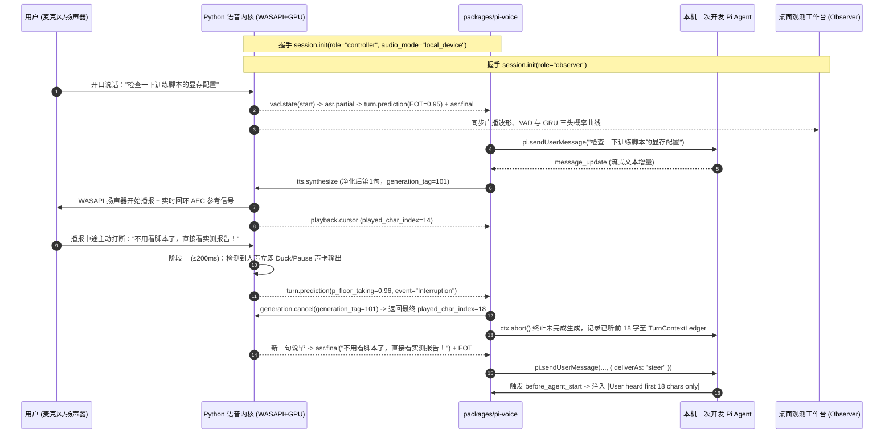

# VoiceAgent 本地实时通信与实验控制协议规范（V2.0）

本文档基于 [PRD V2.0](VoiceAgent_PRD.md) 与 [模块设计 V2.0](MODULES.md)，定义 **Python 语音推理内核（`127.0.0.1:8765`）** 与两类客户端——**热插拔 Pi `/voice` 插件（`packages/pi-voice`）** 及 **桌面算法实验观测工作台（`apps/desktop`）** 之间的统一实时 WebSocket 协议与 REST 实验控制契约。

---

## 1. 传输基线与多客户端角色模型

- **服务绑定地址**：固定监听本机回环 `http://127.0.0.1:8765` 与 `ws://127.0.0.1:8765/ws/v1/voice`（严禁默认暴露至局域网/公网）。
- **双客户端协同角色（Controller + Observer）**：
  1. **`role: "controller"`（主控会话端）**：同一时刻最多激活一个主控端（日常使用时为挂载了 `/voice` 的本机二次开发 Pi Agent；独立离线实验时可切换为桌面工作台）。负责驱动会话轮次、下发待合成短句与取消指令。
  2. **`role: "observer"`（旁路观测端）**：桌面实验观测工作台打开时默认以 `observer` 接入，**零干扰同步接收**主控会话的全部实时遥测事件（波形 RMS、VAD 概率、`CausalTurnGRU` 三头概率、ASR Partial/Final、TTS 分块进度、播放游标与 GPU 显存快照），实现“终端里跟 Pi 语音写代码，旁边工作台实时看模型内部概率曲线”。
- **双音频传输模式（`audio_mode`）**：
  1. **`"local_device"`（CLI Pi `/voice` 默认）**：Python 内核直接通过 WASAPI 打开本机麦克风与扬声器；WebSocket 仅传输轻量 UTF-8 JSON 事件，零跨进程音频拷贝。
  2. **`"ws_pcm"`（工作台音频注入回放 / 浏览器试听）**：通过 24 字节小端序二进制帧收发 16kHz 上行麦克风/文件 PCM 与 24kHz 下行 TTS PCM。

---

## 2. 三级会话与生成防串台 ID 机制

全双工可打断场景下，新旧轮次的语音识别与 TTS 合成异步并发，所有事件强制携带三级关联标识以杜绝“已打断旧回复的残余语音窜入新轮次”：

| 标识符 | 生成方与生命周期 | 过滤铁律 |
|---|---|---|
| `session_id` | 主控端握手时生成（如 `"sess_pi_01"`） | 会话重置或关闭时，Python 内核立即清空对应 ASR 流式 Cache 与 `CausalTurnGRU` 隐状态 |
| `turn_id` | 每轮用户发言开始或主动打断成立时递增（如 `"turn_0008"`） | 迟到的旧 `turn_id` 事件仅允许进入观测日志，严禁触发当前轮次的 `sendUserMessage` |
| `generation_id` / `generation_tag` | 每次回复合成流唯一标识（如 `"gen_0008_a"` 对应 32 位整数 `generation_tag: 801`） | 一旦收到 `generation.cancel`，Python TTS 队列与声卡播放缓冲**双端原子丢弃**所有匹配该标识的待播分块 |

---

## 3. WebSocket 帧格式定义

### 3.1 UTF-8 JSON 事件统一信封（Event Envelope）

```json
{
  "v": 2,
  "type": "turn.prediction",
  "event_id": "evt_01J9X2K8",
  "timestamp_ms": 1764249600120,
  "session_id": "sess_pi_01",
  "turn_id": "turn_0005",
  "generation_id": "gen_0005_a",
  "payload": {}
}
```

### 3.2 Binary PCM 音频帧格式（仅 `audio_mode: "ws_pcm"` 使用）

采用 **24 字节小端序（Little-Endian）固定帧头 + 单声道 `int16` PCM 数组**：

| 字节偏移 | 字段 | 类型 | 说明 |
|---:|---|---|---|
| `0..1` | `magic` | `uint16` | 固定魔数 `0x5641` (`"VA"`) |
| `2` | `version` | `uint8` | 协议版本（兼容 `1` / `2`） |
| `3` | `stream_kind` | `uint8` | `1` = 上行采集/回放音频 (`16000 Hz`)；`2` = 下行 TTS 音频块 (`24000 Hz`)；`3` = 上行 AEC 参考流 |
| `4..7` | `seq` | `uint32` | 单调递增帧序号 |
| `8..15` | `pts_ms` | `float64` | 单调时钟毫秒时间戳 |
| `16..19` | `sample_rate` | `uint32` | 采样率（`16000` 或 `24000`） |
| `20..23` | `generation_tag` | `uint32` | 下行 TTS 块绑定的数值标签，支持客户端 `O(1)` 过滤已取消任务 |
| `24..N` | `pcm_payload` | `int16[]` | 原始小端序 16-bit 单声道采样数据 |

> **多句并发安全约束**：服务端向同一 WebSocket 发送 `tts.chunk` JSON 元数据帧及其紧随的 Binary PCM 帧时，必须持有连接级异步发送锁（Send Lock），严禁跨协程交错插入其他帧。

---

## 4. 核心 WebSocket 事件目录

### 4.1 会话与硬件控制事件（Client → Python）

| 事件类型 | 说明与关键 Payload 字段 |
|---|---|
| `session.init` | 握手初始化：`{ "role": "controller" \| "observer", "audio_mode": "local_device" \| "ws_pcm", "input_device": null, "output_device": null, "turn_strategy": "hybrid", "tts_engine": "qwen3" }` |
| `audio.control` | 控制本地音频守护状态：`{ "action": "start_mic" \| "stop_mic" \| "ptt_down" \| "ptt_up" \| "duck" \| "pause" \| "resume", "duck_gain": 0.15 }` |
| `tts.synthesize` | 下发经净化的可朗读单句：`{ "sentence_index": 0, "text": "我已经帮你定位到配置文件里的精度参数。", "generation_tag": 501, "speaker_profile": "default" }` |
| `generation.cancel` | 主动打断或宿主取消生成：`{ "target_generation_id": "gen_0005_a", "generation_tag": 501, "reason": "user_interruption" }` |
| `playback.ack` | 当 `audio_mode="ws_pcm"` 时由客户端回传声卡已播进度：`{ "playback_state": "playing", "played_char_index": 12, "played_duration_ms": 1480 }` |

### 4.2 实时感知、轮次预测与遥测事件（Python → Controller & Observers）

| 事件类型 | 说明与关键 Payload 字段 |
|---|---|
| `audio.level` | 高频采集/播放电平与波形摘要（50Hz）：`{ "mic_rms_db": -24.5, "spk_rms_db": -60.0, "aec_active": true }` |
| `vad.state` | VAD 实时概率与边界变化：`{ "is_speech": true, "vad_prob": 0.93, "pts_ms": 18420.0, "event": "start" \| "ongoing" \| "end" }` |
| `asr.partial` | 流式增量转写：`{ "text": "帮我把训练脚本改成", "stability": 0.85, "compute_ms": 15.4 }` |
| `asr.final` | 句段确认转写：`{ "text": "帮我把训练脚本改成 BF16 混合精度。", "audio_duration_ms": 2360, "compute_ms": 21.1, "model_id": "whisper-lora-v1" }` |
| `turn.prediction` | `CausalTurnGRU` 实时三头输出与综合建议：<br>`{ "p_completion": 0.94, "p_floor_taking": 0.02, "p_non_floor_feedback": 0.01, "recommended_event": "EOT", "adapter_id": "causal-gru-L2H128-v1", "step_ms": 0.42 }` |
| `playback.cursor` | `local_device` 模式下 Python 声卡守护实时上报真实硬件已播进度：<br>`{ "mode": "playing", "played_char_index": 19, "played_duration_ms": 2150, "generation_id": "gen_0005_a" }` |
| `tts.chunk` | TTS 音频分块完成通知（`ws_pcm` 模式下紧跟二进制音频帧）：<br>`{ "sentence_index": 0, "chunk_index": 0, "char_start": 0, "char_end": 19, "duration_ms": 2150, "ttfa_ms": 268, "rtf": 0.62 }` |
| `telemetry.gpu` | GPU 显存与活跃模型状态快照（1Hz）：<br>`{ "device": "NVIDIA GeForce RTX 5070 Laptop GPU", "vram_allocated_mb": 2402.4, "vram_total_mb": 8151.0, "active_models": { "asr": "...", "turn": "...", "tts": "..." } }` |
| `error` | 结构化异常与自动降级通知：`{ "module": "tts", "code": "CHECKPOINT_LOAD_FAILED", "message": "...", "recoverable": true }` |

---

## 5. REST 实验与模型管理接口（供桌面工作台与评测脚本调用）

除实时 WebSocket 外，`inference/server.py` 暴露以下本地 HTTP 接口支撑模型热切换与 A/B 盲测：

| 方法与路径 | 用途 | 请求 / 响应摘要 |
|---|---|---|
| `GET /health` | 存活检查、CUDA 设备信息与当前生效模型列表 | 返回 `{ status, cuda_available, device_name, vram_mb, active_models }` |
| `GET /v1/models/registry` | 获取 `models/registry.json` 中全部可用 Checkpoint 与对应验证集指标 | 返回 ASR / Turn Adapter / TTS 候选列表 |
| `POST /v1/models/activate` | 运行时热切换指定子模块模型权重或轮次策略 | 请求 `{ "task": "asr" \| "turn_adapter" \| "tts", "checkpoint_id": "..." }` |
| `POST /v1/ab-test/asr` | 对同一段上传/指定 WAV 并发执行多个 ASR Checkpoint 对比 | 返回各模型的 `transcript`、`compute_ms`、`rtf` 及参考文本存在时的 `wer` / `cer` |
| `POST /v1/ab-test/tts` | 对同一测试文本使用多个 TTS Checkpoint（如 Pretrained / Zero-shot / Finetuned）生成对比音频 | 返回匿名打乱映射表（支持盲测模式）及各段 WAV Base64/本地临时 URL、`ttfa_ms`、`rtf` |
| `GET /v1/experiments` | 读取 `docs/experiments/` 下所有标准实验 Manifest 与 Markdown 摘要 | 供桌面工作台实验看板直接渲染 |

---

## 6. 全双工核心交互时序图

### 6.1 Pi `/voice` 对话、流式播报与主动打断（`local_device` 模式 + 工作台旁路示波）


