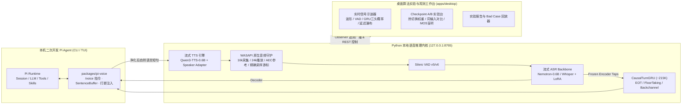

# VoiceAgent 产品需求文档（PRD）

**版本：** V2.0（Living Specification）  
**产品定位：** 本地全双工语音训练推理内核 + 热插拔 Pi `/voice` 语音模块 + 桌面算法实验观测工作台  
**目标平台：** Windows 11 + NVIDIA GPU（本地 RTX 5070 8GB 实时推理 / WSL2 & AutoDL 训练微调）  
**开发语言：** Python（语音算法训练与推理核心） + TypeScript（Pi 扩展插件与实验工作台）  
**参考基线：** `Voice-Light`（全双工因果轮次预测）、`local-voice`（流式语音管线与播放对齐）、AGY / Codex 语音模式（宿主无感热插拔体验）

---

## 1. 产品背景与战略重构（V1 → V2）

### 1.1 核心认知收敛

在完成基础全双工链路与 RTX 5070 实机闭环验证后，项目边界做如下战略收敛：

1. **核心壁垒在语音算法而非重复造 Agent 壳**：项目的核心研发价值集中在 **流式 ASR 领域/口音微调、流式 TTS 说话人音色微调、基于冻结 ASR Encoder 特征的因果轮次预测与打断检测（Turn Adapter），以及消费级 8 GB 显存下的低延迟流式推理优化**。
2. **智能体交互采用热插拔 Pi 插件形态**：开发者本机已拥有成熟二次开发的 **Pi Agent**。因此 VoiceAgent 不再单独维护一套独立的桌面聊天智能体外壳，而是提供标准化的 **Pi Package 扩展包（`packages/pi-voice`）**。通过 `/voice` 命令或快捷键即可像 Antigravity（AGY）/ Codex 语音模式一样热插拔挂载到既有 Pi Agent 上，100% 复用宿主的会话树、模型路由、Skills、MCP 与工具链。
3. **桌面应用全面转型为「算法实验与观测工作台」**：已有 Electron 桌面端（`apps/desktop`）定位升级为 **Voice R&D Workbench**，专用于实时观测全双工语音信号（波形 / Silero VAD / Causal GRU 三头概率曲线 / 逐段延迟 / 显存水位）、热切换不同训练阶段的模型 Checkpoint、开展多模型 A/B 盲测对比与回放分析 Bad Cases。
4. **数据集零本地囤积原则**：所有公开训练语料与大规模评测集统一存放于 **Google Drive** 或通过 Hugging Face `datasets(..., streaming=True)` 流式按需读取，不在本机 SSD 囤积原始音频大文件。

### 1.2 三支柱产品形态

```text
┌────────────────────────────────────────────────────────────────────────────┐
│                   支柱二：热插拔 Pi 语音扩展 (packages/pi-voice)             │
│   挂载至本机二次开发 Pi Agent │ /voice 开关 │ Alt+V 快捷键 │ 播放游标对齐   │
└───────────────────────────────┬────────────────────────────────────────────┘
                                │ 控制流 / 转写流 / 句级待播文本 (WS 127.0.0.1)
                                ▼
┌────────────────────────────────────────────────────────────────────────────┐
│          支柱一：Python 本地语音训练与实时推理内核 (inference/training/eval)   │
│  [在线推理] WASAPI低延迟声卡守护 │ Silero VAD │ 流式ASR+特征Tap │ CausalGRU │
│            流式 Qwen3-TTS │ 硬件级播放游标追踪与 AEC 参考环回               │
│  [离线研发] ASR LoRA微调 │ Turn Adapter训练 │ TTS音色微调 │ 云盘流式数据管道 │
└───────────────────────────────▲────────────────────────────────────────────┘
                                │ 旁路实时遥测 / Checkpoint热切换 / A/B盲测回放
┌───────────────────────────────┴────────────────────────────────────────────┐
│               支柱三：桌面算法实验与观测工作台 (apps/desktop)                 │
│   VAD & GRU三头示波器 │ 模型注册表热插拔 │ ASR/TTS A/B盲测 │ Bad Case回放台  │
└────────────────────────────────────────────────────────────────────────────┘
```

### 1.3 核心研发目标

1. **算法深度**：完成流式 ASR 微调（`ASR-A0~A3`）、Causal GRU 轮次与打断模型训练消融（`TURN-A0~A5`）、流式 TTS 零样本与少样本音色微调对比（`TTS-A0~A3`），产出具备独立测试集支撑的量化实验报告。
2. **工程性能**：在 8 GB VRAM（RTX 5070 Laptop）限制下实现 VAD + ASR + Turn Adapter + TTS 四模型稳定同卡常驻，攻克流式 TTS 首包延迟（TTFA）与实时率（RTF < 1）瓶颈。
3. **无缝集成**：在不动用宿主源码的前提下，通过 `pi install ./packages/pi-voice` 为本机二次开发 Pi Agent 赋予全双工免提对话、按住说话（PTT）、实时语音打断（Barge-in）与真实已听上下文对齐能力。

---

## 2. 系统总体架构

### 2.1 在线全双工推理与双端协同架构

Python 语音内核作为本机唯一的 GPU 与低延迟音频服务守护进程（`127.0.0.1:8765`），同时支持 **Pi `/voice` 主控接入** 与 **桌面工作台旁路观测/独立实验接入**：



### 2.2 云端流式离线训练与评测闭环架构

```text
Google Drive (VOICE_AGENT_DATA_ROOT) / Hugging Face Datasets (streaming=True)
                                  │
                    (按需流式读取，本机 SSD 零数据集囤积)
                                  ▼
                  会话级严格切分 (Session-level Train / Val / Test)
                                  │
        ┌─────────────────────────┼─────────────────────────┐
        ▼                         ▼                         ▼
   training/asr/          training/turn_adapter/       training/tts/
 (LoRA / 指令与口音微调)   (冻结Encoder特征 + 因果GRU)  (Zero-shot基线 vs 音色微调)
        │                         │                         │
        └─────────────────────────┼─────────────────────────┘
                                  ▼
                    evaluation/ 独立测试集门禁校验
          (WER/CER · EOT F1/误截断 · Speaker Sim · 流式因果等价断言)
                                  │
                                  ▼
                 models/registry.json (模型版本与指标注册表)
                                  │
                                  ▼
          桌面实验观测工作台一键热加载验证 ──► Pi /voice 生产默认挂载
```

---

## 3. 功能需求矩阵（Functional Requirements）

优先级定义：
- **P0（核心基线）**：热插拔语音闭环与算法训练评测必需能力。
- **P1（核心研发）**：全双工打断、微调实验对比与观测工作台核心能力。
- **P2（进阶优化）**：推测式生成、低比特量化与扩展场景能力。

### 3.1 底层语音推理内核需求（Layer 1）

| 编号 | 模块 | 功能描述 | 优先级 | 验收要求 |
|---|---|---|---|---|
| **FR-01** | 音频守护 | 双模式音频 I/O（`local_device` 原生声卡直连 + `ws_pcm` 协议流输入） | P0 | CLI Pi 无需浏览器即可低延迟收发语音；工作台支持 WAV 测试集流式注入 |
| **FR-02** | 音频前处理 | 16kHz 单声道重采样、300ms Pre-roll 句首缓冲与有界 Ring Buffer | P0 | 句首辅音零截断；长时运行内存严格恒定 |
| **FR-03** | 回声与降噪 | 基于真实播放参考信号的声学回声消除（AEC）与背景降噪（NS） | P1 | 扬声器外放播报时，不将助手自身语音误识别为用户打断指令 |
| **FR-04** | VAD | Silero VAD 帧级语音概率检测与起止边界事件广播 | P0 | 32ms 帧窗口实时上报，仅作为证据源，不单独裁决整轮发言结束 |
| **FR-05** | 流式 ASR | 本地流式语音识别（Partial / Final 增量输出与流式状态缓存管理） | P0 | 支持 `Nemotron-0.6B`（WSL2/Linux）与多语种 `Whisper`（Windows CUDA）双后端 |
| **FR-06** | 特征提取 | 冻结 ASR Encoder 多层因果特征实时提取接口（Encoder Taps） | P0 | 严格无未来帧泄漏（因果误差上界 $\le 10^{-5}$） |
| **FR-07** | 模型热插拔 | ASR / Turn Adapter / TTS 运行时动态加载微调 Checkpoint | P1 | 切换权重无需重启进程，切换失败自动回退至上一稳定权重 |
| **FR-08** | 轮次与打断 | 区分 6 类交互事件并执行两阶段音频控制（Duck / Pause / Resume / Cancel） | P1 | 详见 §3.2 六类全双工交互矩阵 |
| **FR-09** | 流式 TTS | `Qwen3-TTS-0.6B` 本地句级流式合成、音色切换与毫秒级取消释放 | P0 | 收到 `generation.cancel` 后立即终止后续 Chunk 推理并释放显存 |

### 3.2 六类全双工轮次与打断裁决矩阵（Turn Manager）

系统综合 `VAD 证据 + CausalTurnGRU 三头概率 + 助手当前播放状态 + ASR 增量词汇 + 保守静音超时` 输出裁决：

| 交互事件 | 典型场景示例 | 期望系统动作 |
|---|---|---|
| **1. EOT（发言完成）** | “帮我看一下当前项目的测试覆盖率。” | 立即触发 `turn.commit` 提交给宿主 Pi Agent |
| **2. HOLD（句中思考停顿）** | “把那个配置文件……嗯……改成 BF16 精度。” | 保持监听，禁止在停顿处提前截断抢话 |
| **3. Backchannel（非抢话附和）** | 助手播报中途用户说：“嗯”、“OK”、“明白” | 阶段一短暂 Duck 音量，识别为附和后平滑 `Resume` 继续播报原回复 |
| **4. Short Interjection（语义短插话）** | 助手啰嗦时用户插话：“说重点”、“讲中文”、“快一点” | 区分于纯附和：触发打断并携带已听前缀，通过 `steer` 让 Pi 按新要求简短续答 |
| **5. Interruption（主动抢话改向）** | “停一下，先别跑训练了，先检查数据路径。” | ≤250ms 暂停音频，≤500ms 清空播放队列并调用 `ctx.abort()` 取消旧生成，转入新轮次 |
| **6. Noise（环境非人声干扰）** | 键盘敲击、咳嗽、翻书、椅子摩擦 | 抑制误触发，不中断当前播报与生成任务 |

### 3.3 热插拔 Pi `/voice` 扩展模块需求（Layer 2）

| 编号 | 功能 | 详细规范 | 优先级 |
|---|---|---|---|
| **FR-10** | 标准 Pi Package 封装 | 遵循 `@earendil-works/pi-coding-agent` 规范，通过 `pi install ./packages/pi-voice` 或 `pi -e` 零拷贝热插拔，宿主依赖仅声明于 `peerDependencies` | P0 |
| **FR-11** | `/voice` 命令与快捷键 | 注册 `/voice [on\|off\|ptt\|handsfree\|status\|voice-id]`、快捷键 `Alt+V`（一键开关/按住说话）及 CLI 启动参数 `--voice` | P0 |
| **FR-12** | TUI 状态栏无感融合 | 通过 `ctx.ui.setStatus("voice", ...)` 在宿主 Pi 底部状态栏实时显示 `🎙 Listening` / `🔊 Speaking` / `⏸ Ducked` / `⚡ RTT`，不破坏原有终端排版 | P0 |
| **FR-13** | 流式文本净化与句级播报 | 监听 `message_update` 流式事件，剥离代码块（`` ``` ``）、路径串、工具参数与 `<think>` 块；首句按短标点激进切分送 TTS，降低首包可听延迟 | P0 |
| **FR-14** | 原生打断与运行中变向 | 确认用户主动打断时调用 `ctx.abort()` 终止当前生成，并通过 `pi.sendUserMessage(text, { deliverAs: "steer" })` 将新语音指令无缝注入宿主 | P1 |
| **FR-15** | 真实已听进度上下文同步 | 维护三账本（`LLM 已生成文本` / `扬声器实际已播文本 audiblePrefix` / `已完成工具结果`）；若回复被中途打断，在下一轮 `before_agent_start` 注入未听完说明，且**完整保留已执行工具记录** | P1 |
| **FR-16** | 语音模式工具安全协同 | 完全尊重二次开发 Pi Agent 自身的权限体系；当开启语音审批辅助时，基于 `tool_call` + `ctx.ui.confirm(..., { timeout: 15000 })` 提供语音提示，超时或语义含糊一律默认拒绝（Fail-Closed） | P1 |

### 3.4 桌面算法实验与观测工作台需求（Layer 3）

桌面端（`apps/desktop`）不再承担日常 Agent 生产力主入口，而是围绕**语音算法实验闭环**提供四大专业视图：

| 编号 | 工作台模块 | 功能描述 | 优先级 |
|---|---|---|---|
| **FR-17** | **实时全双工信号示波台** | 同步绘制麦克风波形、Silero VAD 概率轨迹、`CausalTurnGRU` 三头概率实时曲线（`p_completion` / `p_floor_taking` / `p_backchannel`）、当前播放游标字符高亮及 RTX 5070 显存水位；支持作为 `Observer` 旁路观测正在运行的 Pi `/voice` 会话 | P0 |
| **FR-18** | **Checkpoint 注册表与热切换器** | 读取 `models/registry.json`，支持在 GUI 中一键切换 ASR（基线 vs LoRA）、Turn策略（`fixed_silence` / `smart_turn` / `causal_gru` / `hybrid`）与 TTS（预训练 vs Zero-shot vs 微调音色） | P0 |
| **FR-19** | **ASR / TTS 多模型 A/B 对比实验台** | **ASR 对比**：上传或录制同一段测试语音，并排展示基线模型与微调模型的转写结果、WER/CER 差异及耗时；**TTS 盲测对比**：输入同一段文本，匿名生成 `Model A / B / C` 音频供主观 MOS 打分与音色相似度对比 | P1 |
| **FR-20** | **实验大盘与 Bad Case 回放台** | 可视化渲染 `docs/experiments/*.json` 实验清单与消融表格；一键加载 Bad Case 音频片段重新注入推理管线，复现并定位误截断或识别错误帧 | P1 |

---

## 4. 核心算法研发与实验体系需求

### 4.1 数据存储与防泄漏硬约束

1. **云端存储与流式加载**：训练数据集统一存放于 Google Drive（通过环境变量 `VOICE_AGENT_DATA_ROOT` 指向挂载盘路径）或通过 Hugging Face `streaming=True` 在线流式读取；本机仓库 `data/` 目录仅允许存放极小规模冒烟测试样例、会话划分清单（JSON/CSV）与脱敏缓存特征。
2. **会话级隔离（Session-level Split）**：所有微调与验证必须按完整对话 `session_id` 与 `speaker_id` 划分 `train / val / test`，严禁同一通对话切片跨集合混入。
3. **测试集只读铁律**：所有分类阈值（如 EOT 阈值、打断阈值）仅允许在 `val` 集寻优固化，`test` 集严格只读且允许如实报告负面实验结论。

### 4.2 实验一：Causal GRU 轮次预测与全双工打断（`TURN-A0` ~ `TURN-A5`）

- **网络架构**：冻结流式 ASR Encoder → 提取多层因果隐状态并与 `assistant_playback_state` 拼接 → 单向 `CausalTurnGRU`（默认 2 层 128 维，约 215K 参数）→ 三分类头（`Completion` / `Floor Taking` / `Non-floor Feedback`）。
- **实验对照表**：
  - `TURN-A0`：固定静音阈值（700ms）
  - `TURN-A1`：纯 Silero VAD 端点检测
  - `TURN-A2`：Smart Turn 启发式时序基线
  - `TURN-A3`：Acoustic Log-Mel (80d) + Causal GRU（验证预训练语义特征 vs 纯声学特征）
  - `TURN-A4`：ASR Encoder 中间特征 + Causal GRU（核心模型，含层数/维度消融）
  - `TURN-A5`：Causal GRU + 词汇规则 + 保守超时混合控制器（生产默认）
- **核心指标**：`EOT F1`、`EOT Recall`、`False Cutoff Rate`（句中停顿误截断率）、`False Interruption Rate`、`Backchannel False-Cancel Rate`、单步 GPU 耗时与因果数值等价误差。

### 4.3 实验二：流式 ASR 领域指令与口音微调（`ASR-A0` ~ `ASR-A3`）

- **研发目标**：解决编程/终端语音交互中的中英夹杂技术术语（如仓库名、CLI 命令、精度参数 `bf16` / `LoRA` / `RTX 5070`）及个人口音导致的识别偏差（实测闭环基线已捕获典型 Bad Case：`"RTX 5070"` 被 `whisper-base.en` 误识别为 `"RTX 577"`）。
- **实验对照表**：
  - `ASR-A0`：原始预训练流式模型（`Nemotron-0.6B` / `Whisper` 基线）
  - `ASR-A1`：Prompt / 热词上下文偏置增强（无需改权重基线）
  - `ASR-A2`：参数高效微调（LoRA / Adapter，基于云端流式技术口令与口音语料）
  - `ASR-A3`：LoRA 微调 + 混响/键盘敲击/底噪数据增强
- **核心指标与门禁**：领域测试集 `WER / CER`、技术术语精确召回率、**通用公开测试集 WER 退化幅度（防灾难性遗忘门禁 ≤ +0.5%）**、流式推理 `RTF` 与峰值显存。

### 4.4 实验三：流式 TTS 说话人音色适配（`TTS-A0` ~ `TTS-A3`）

- **研发目标**：围绕 `Qwen3-TTS-12Hz-0.6B` 探索目标音色克隆与少样本微调在自然度、音色还原度及专有词汇朗读稳定性上的边界。
- **实验对照表**：
  - `TTS-A0`：原始预训练默认音色
  - `TTS-A1`：**3 秒参考音频 Zero-shot Voice Cloning（强制对照强基线）**
  - `TTS-A2`：少样本说话人微调（5–15 分钟高质量授权语音）
  - `TTS-A3`：数据规模消融（3 分钟 vs 10 分钟 vs 30 分钟微调收益曲线）
- **核心指标**：说话人嵌入余弦相似度（`Speaker Similarity`）、ASR 回环重识别 `CER / WER`、首音频块延迟 `TTFA`、实时率 `RTF` 及工作台双盲 `MOS` 评分。

### 4.5 实验四：8 GB 消费级显卡流式推理优化（`OPT-01` ~ `OPT-04`）

基于 RTX 5070 Laptop（8,151 MiB）已完成的实测诊断（四模型同卡峰值显存仅 `2,402.4 MB`，ASR `RTF = 0.0417`，但 Windows 原生无 `flash-attn` 下 `Qwen3-TTS` 热启动 `RTF = 5.006`），确立高优先级推理优化课题：
- `OPT-01`：精度与算子加速对比（`FP32 Eager` vs `BF16 SDPA` vs WSL2 `FlashAttention-2` + `torch.compile` / CUDA Graphs）。
- `OPT-02`：流式 TTS 首包与吞吐加速（句首短子句切分 + 流式 Token 解码 Chunk 调优，将 `Qwen3-TTS` RTF 压降至 `< 1.0`，同时保留极低延迟神经 TTS 备选引擎供日常高频编码对话切换）。
- `OPT-03`：多模型并发 CUDA Stream 隔离（验证边说边听并发时 TTS 合成不阻塞 20ms ASR/VAD 帧处理）。
- `OPT-04`（P2）：高置信度 EOT 推测式预热生成（量化端到端延迟节省 vs 无效撤销 Token 比例）。

---

## 5. 非功能性指标基线

| 维度 | 当前实测基线（RTX 5070 8GB） | V2 阶段验收目标 | 终极优化目标 |
|---|---:|---:|---:|
| **四模型同卡峰值显存** | **2,402.4 MB**（余量 5.75 GB） | ≤ 5.5 GB（含流式 KV Cache 峰值） | ≤ 4.5 GB |
| **流式 ASR 实时率 (RTF)** | **0.0417** | < 0.10 | < 0.05 |
| **Turn Adapter 单步推理延迟** | **0.022 – 32.8 ms** | ≤ 15 ms | ≤ 5 ms |
| **流式 TTS 实时率 (RTF)** | 5.006（Win 原生无 FA2） | **< 0.85（WSL2 FA2 / 编译加速）** | **< 0.40** |
| **语音尾音至首帧可听播放 (E2E P50)** | 待接入真实 Pi 流式闭环复测 | **≤ 1,800 ms** | **≤ 950 ms** |
| **疑似打断至音量避让 (Duck/Pause P95)** | 18 ms（管线内） | **≤ 200 ms（含硬件声卡缓冲）** | **≤ 120 ms** |
| **确认打断至终止生成 (`ctx.abort` P95)** | — | **≤ 450 ms** | **≤ 280 ms** |

---

## 6. 项目范围边界（Out of Scope）

以下内容明确**不纳入**本项目开发范围，确保精力 100% 聚焦语音模型训练、推理优化与全双工插件体验：
1. **不重复开发独立 Agent Runtime、会话管理器、MCP 客户端或通用 Coding 工具集**（全部由本机二次开发 Pi Agent 宿主提供）。
2. **不在本机硬盘存储大规模原始语音数据集**（强制走 Google Drive 挂载或 HF Streaming）。
3. **不从零预训练百亿参数基座大模型或自研端到端 Speech-to-Speech 基座**。
4. **不构建多租户公网 SaaS 后端或移动端 App**（推理服务严格绑定 `127.0.0.1`）。

---

## 7. 核心交付物清单

1. **Python 语音训练与推理内核**（`inference/`、`training/`、`evaluation/`）：支持流式 VAD/ASR/TurnGRU/TTS 同卡推理、云端流式微调脚本与自动化评测基准。
2. **热插拔 Pi 语音扩展包**（`packages/pi-voice`）：一行命令挂载至本机二次开发 Pi Agent，提供 `/voice` 全双工语音交互模式。
3. **桌面算法实验与观测工作台**（`apps/desktop`）：支持实时信号示波、Checkpoint 热插拔、ASR/TTS A/B 盲测对比与实验结果可视化。
4. **可复现实验报告与模型权重注册表**（`docs/experiments/` + `models/registry.json`）：完整覆盖 Turn Adapter 消融、ASR LoRA 微调、TTS 音色适配与 RTX 5070 推理加速前后对比。
